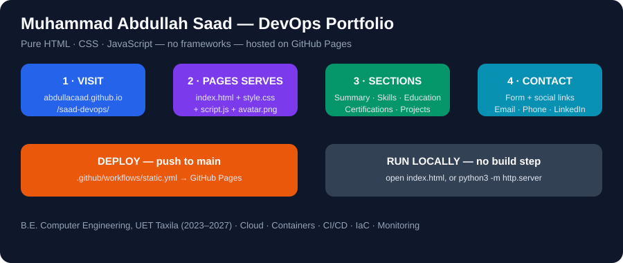

<div align="center">

# Muhammad Abdullah Saad — DevOps Portfolio

**Aspiring DevOps Engineer | Cloud, Containers & Automation | UET Taxila**


*HTML5 · CSS3 · Vanilla JavaScript · GitHub Pages*

🌐 **Live Site:** [abdullacaad.github.io/saad-devops](https://abdullacaad.github.io/saad-devops/)

</div>

---

## 🎯 What this is

A personal portfolio website built with pure HTML, CSS, and JavaScript — no frameworks, no dependencies. It showcases my skills, projects, and certifications in DevOps and Cloud Computing.

> **The idea:** one clean page that says who I am, what I can do, and how to reach me.

## 🖼️ Site map



📸 **Screenshots:** no screenshot file is in this repo — the old README referenced `bhai.png`, which does not exist here, so no preview image is shown. A real screenshot of the live site can be added later: save it as `docs/screenshots/site.png` and it will show here. No fake screenshots are included.

## 📄 Sections

- **Summary** — Who I am and what I'm about
- **Technical Skills** — Cloud, Containers, CI/CD, IaC, Monitoring, Scripting & more
- **Education** — B.E. Computer Engineering at UET Taxila (2023–2027)
- **Certifications** — Cisco Networking Academy, HP LIFE
- **Projects** — Linux Admin, Docker Setup, Student Management System, IoT Monitor
- **Contact** — Contact form + social links

### Technical skills (as listed on the site)

| Area | Skills |
|------|--------|
| Cloud | AWS, Azure, GCP |
| Containers & Orchestration | Docker, Kubernetes, Helm |
| CI/CD | Jenkins, GitLab CI/CD, GitHub Actions |
| Infrastructure as Code | Terraform, Ansible |
| Monitoring & Observability | Prometheus, Grafana, ELK Stack |
| Scripting & OS | Linux, Bash, Shell Scripting, Python |
| Networking & Web | Nginx, Apache, TCP/IP |
| Tools & Methods | Git, GitHub, Vagrant, VirtualBox, WSL, Agile, Scrum, DevSecOps |

### Education

**Bachelor of Engineering in Computer Engineering** — University of Engineering and Technology (UET) Taxila, 2023 – Present

- Core subjects include Operating Systems, Computer Networks, Data Structures, and Software Engineering.
- Hands-on projects in Linux administration, containerization, and cloud computing alongside coursework.
- Lab-based learning with Docker, Kubernetes, and Terraform.

### Certifications

- **Cisco Networking Academy Graduate** — professional certification courses in networking and security fundamentals
  - Introduction to IoT — Cisco Networking Academy
  - Introduction to Cybersecurity — Cisco Networking Academy
- **Data Science & Analytics** — HP LIFE

### Featured projects

| Project | What it is |
|---------|-----------|
| Linux System Administration | Configured and managed Linux environments using command-line tools — file permissions, processes, system utilities, package management. |
| Docker-Based Application Setup | Built and executed containerized applications with Docker — image creation, container lifecycle management, environment isolation. |
| Student Management System | Complete student record management system in C++ with CRUD operations via file handling and modular programming. |
| IoT Monitoring System | Basic IoT setup for sensor data monitoring, with communication between hardware components and hardware–software integration. |

## 🛠️ Tech stack

| Layer | Technology |
|-------|-----------|
| Markup | HTML5 |
| Styling | CSS3 (custom, no framework) |
| Logic | Vanilla JavaScript |
| Fonts / Icons | Inter (Google Fonts), Font Awesome 6.5.0 |
| Hosting | GitHub Pages |

## ⚡ View / run locally

```bash
git clone https://github.com/abdullacaad/saad-devops.git
cd saad-devops
# Open index.html in your browser — no build step, no server needed.
# Or serve it locally:
python3 -m http.server 8000
# then visit http://localhost:8000
```

## ☁️ Deploy on GitHub Pages

Deployment is already wired up: `.github/workflows/static.yml` deploys the static site to GitHub Pages on every push to `main`. The live site is https://abdullacaad.github.io/saad-devops/

To set it up from scratch in a fresh copy:

1. Push all files to a repo on GitHub.
2. Go to **Settings → Pages** and make sure the source is **GitHub Actions**.
3. Push to `main` — the workflow deploys automatically.

## 📂 Project layout

```
saad-devops/
├── .github/workflows/static.yml   # Deploy static content to Pages
├── index.html                    # Main structure
├── style.css                     # All styling
├── script.js                     # Scroll animations, nav, form
├── avatar.png                    # Profile photo
├── docs/architecture.svg         # Site-map diagram
└── README.md
```

## 📬 Contact

- 📧 abdullahsaadofficial@gmail.com
- 📞 +92 319 7842864
- 💼 [linkedin.com/in/abdullacaad](https://linkedin.com/in/abdullacaad)
- 📍 Taxila, Pakistan

---

© 2025 Muhammad Abdullah Saad · All Rights Reserved
